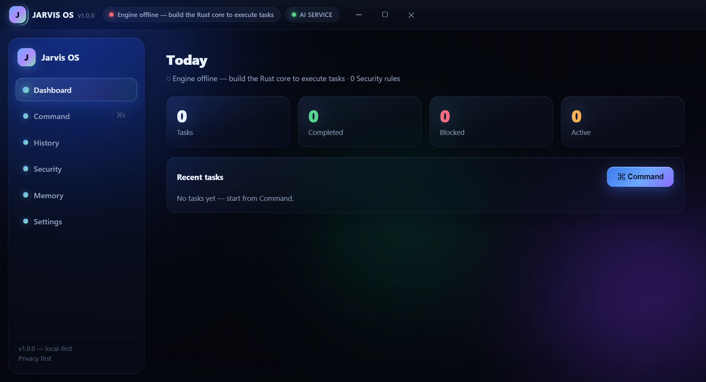

# Amier OS — AI Operating System Assistant

**Privacy-first AI assistant for your machine. The LLM proposes. The rules engine decides. The human confirms. The audit log remembers.**

`v1.0.0` · Windows-first (macOS/Linux supported) · Electron 31 + React 18 + Rust (napi-rs) + FastAPI

Amier OS turns natural language into **validated plans** for everyday device tasks —
then executes every step through a deterministic security pipeline: regex risk rules,
stricter-of merge with the model's advisory risk, a human confirmation gate,
hash-chained audit log. Secrets never leave the OS keychain; command output never
reaches an LLM.



---

## Monorepo layout

```
apps/desktop/        Electron app (main + preload + renderer, React 18 + zustand)
packages/shared/     @jarvis/shared — IPC contract (IPC_METHODS), view types, risk merge
core/                Rust kernel (napi-rs): rules · sandboxed engine · audit chain · SQLite WAL
services/
  ai-orchestrator/   FastAPI: plan · critique · chat(SSE) · explain · summarize · health · metrics
  monitoring/        Prometheus scrape config + provisioned Grafana dashboard
infrastructure/
  docker/            Dockerfile + docker-compose.dev.yml (orchestrator + prom + grafana)
  k8s/               deployment / service / hpa (cloud service only — device control stays local)
scripts/             bootstrap · dev · test_all · seed_db · gen_assets · make_icons
docs/                PRD · ARCHITECTURE · SECURITY · API · ROADMAP · MOBILE · MASTER_PROMPT
.github/workflows/   ci.yml (python+ts+rust) · release.yml (3-OS desktop builds) · mobile.yml (APK)
```

## Quick start (Windows)

```powershell
# 1) one-time setup: npm workspaces + shared build + venv + (optional) Rust core
powershell -ExecutionPolicy Bypass -File scripts\bootstrap.ps1

# 2) run: starts the AI orchestrator (mock provider if no keys) + desktop app
npm run dev            # or: powershell -File scripts\dev.ps1
```

Command bar (**Ctrl+K**) → type a request → review the plan → **Approve** risky steps → run.

- No API key? Works offline: provider falls back to `mock` (deterministic plans) or `ollama`.
- Rust not installed (`cargo` absent)? The app still boots; the engine shows *offline*
  and the UI banner explains it. Install from https://rustup.rs then `npm run core:build`.

## Ready-made binaries

**Windows (x64)** — `npm run dist --workspace apps/desktop` produces:

| Artifact                                 | Path                                              |
| ---------------------------------------- | ------------------------------------------------- |
| Installer (NSIS, per-user, choose dir)   | `apps/desktop/release/Amier OS Setup 1.0.0.exe`   |
| Portable single-file                     | `apps/desktop/release/Amier OS 1.0.0.exe`         |

Unpacked build + blockmap land in `apps/desktop/release/` too. The installers
are unsigned locally (`signAndEditExecutable` is disabled — `rcedit` fails on
non-ASCII build paths); the `release.yml` CI job produces 3-OS builds on `v*` tags.
When a Rust engine was built (`npm run core:build`), `predist` bundles it — the
installer then boots with the real rules engine instead of the offline stub.

**Android** — `apps/mobile` is the companion APK (`com.amier.os`): plans +
streamed chat + server/secret pairing, zero OS execution. Build via the
`mobile.yml` workflow (artifact `Amier-OS-debug-apk`) or locally with JDK 17 +
Android SDK — full pairing guide in [`docs/MOBILE.md`](docs/MOBILE.md).

**Personal-assistant mode** — one-click Desktop shortcut, .env-driven provider
auto-detect, login autostart, and Arabic/English "open YouTube" execution:
[`docs/ASSIST.md`](docs/ASSIST.md).

## Everyday commands

| Command | What it does |
|---|---|
| `npm run dev` | vite dev server + electron (service auto-started by dev.ps1) |
| `npm run build` | build all workspaces (shared → desktop) |
| `npm run typecheck` | strict TS across shared + desktop |
| `npm run test:all` | pytest + tsc + cargo (skips rust silently when cargo is absent) |
| `npm run core:build` | build the Rust kernel → `core/ai_os_core.node` (runs `napi build`) |
| `npm run core:test` | `cargo test` for the kernel |

## Security model in one paragraph

Every plan step crosses the Rust rules engine (~40 rules over cmd/POSIX/PowerShell).
Severity ladder: `deny → high → medium → low`; **anything unclassified defaults to
`medium + confirm`** (fail-closed). The LLM's risk label is advisory and can only make
things stricter — `deny` steps never spawn a process. `medium/high` wait for a human
modal. Child processes run with a scrubbed env (`*KEY*|*TOKEN*|*SECRET*|AWS_*`),
per-risk timeouts, capped and **redacted** output. Every state mutation lands in a
SHA-256 hash-chained audit log; the Security center verifies the chain with one click
and reports the first broken sequence. Full detail: [`docs/SECURITY.md`](docs/SECURITY.md).

## Offline / CI behavior

- `JARVIS_LLM_PROVIDER=mock` (default without keys) → byte-deterministic plans; 21 offline pytest suites.
- The desktop boot self-test validates the IPC whitelist; mismatch ⇒ quit instead of degraded security.
- `scripts/test_all.mjs` runs every suite that the current machine can run (cargo auto-skips).

## Documentation

- [`docs/PRD.md`](docs/PRD.md) — product scope & user journeys
- [`docs/ARCHITECTURE.md`](docs/ARCHITECTURE.md) — system map, layers, event flow, deviations
- [`docs/SECURITY.md`](docs/SECURITY.md) — threat model, data handling, hardening checklist
- [`docs/API.md`](docs/API.md) — orchestrator HTTP API + NAPI/IPC reference
- [`docs/ROADMAP.md`](docs/ROADMAP.md) — shipped v1.0.0 → v1.1 → v1.2 → v2
- [`docs/MASTER_PROMPT.md`](docs/MASTER_PROMPT.md) — authoritative build spec

## Build the desktop packages (optional)

```bash
npm run build --workspace packages/shared
npm run build --workspace apps/desktop        # tsc + vite → dist/
npx electron-builder -C apps/desktop          # installers (see release.yml)
```

## License

MIT — © YAR. See the crate/package manifests (`license: MIT`).
